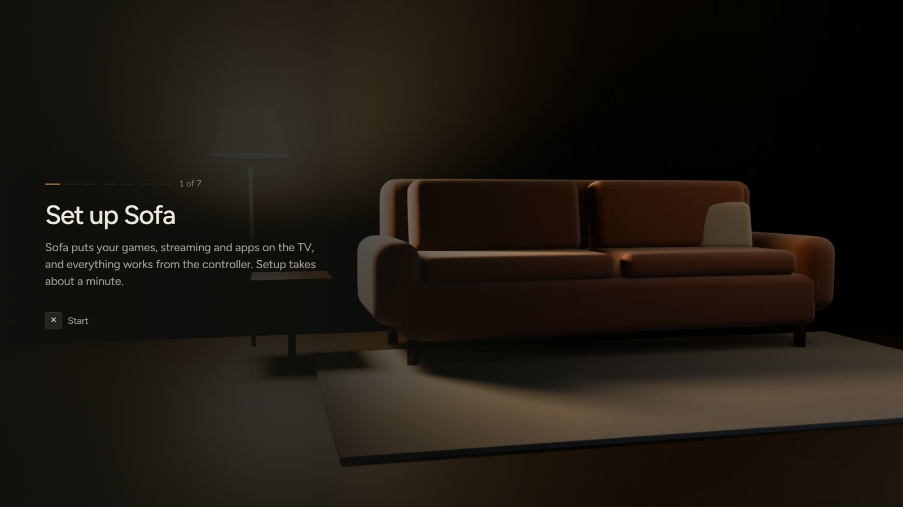
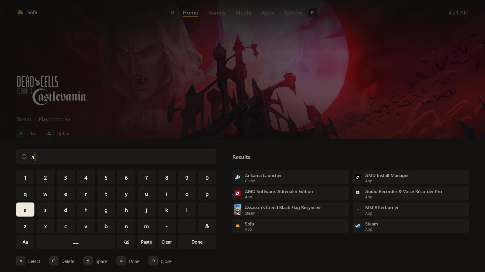
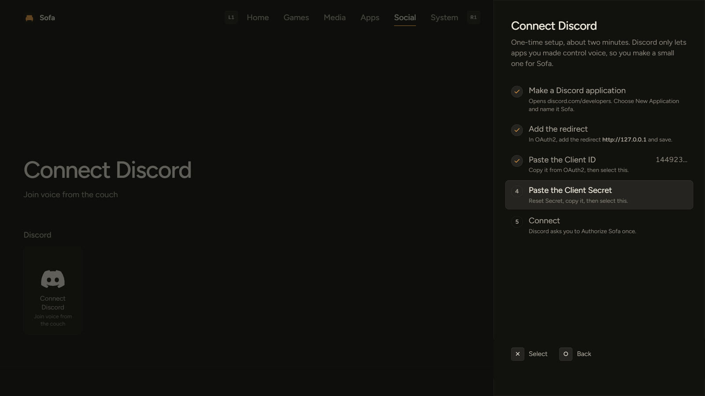

<div align="center">


# Sofa

**Your Windows gaming PC, as a console.**<br>
A controller-first home screen for the TV: every game, stream and app on one screen,<br>
the PS button always takes you home, and Windows stays out of sight until you leave.

[](https://github.com/AGregDev/sofa/releases/latest)
[](#install)
[](QA.md)
[](LICENSE)

[**Download for Windows**](https://github.com/AGregDev/sofa/releases/latest) · [Features](#features) · [Controls](#controls) · [Build from source](#build-from-source)

<br>


</div>

<br>

## Why Sofa

Big Picture is a store. Windows is a desktop. Neither feels like the box under the TV.
Sofa is the missing home screen: it starts with Windows, sits in front like a console
dashboard, and gathers **Steam**, **RecompLauncher** ports, **streaming services** and
your **Start menu apps** into one calm, fast interface you never need a mouse for.

<table>
  <tr>
    <td width="50%"><br><b>PS button, anywhere.</b> Sofa comes forward with the game you were playing first, ready to resume, close or force close.</td>
    <td width="50%"><br><b>A minute of setup.</b> Controller check, library scan, start with Windows, browser, and the Windows and Steam settings worth changing.</td>
  </tr>
  <tr>
    <td><br><b>Search everything.</b> On-screen keyboard with Paste, results as you type.</td>
    <td><br><b>Settings from the pad.</b> Home button, button layout, browser, controller light, sounds, motion.</td>
  </tr>
  <tr>
    <td><br><b>Discord voice on the couch.</b> Join channels, mute and deafen from the controller. Guided one-time setup.</td>
    <td><br><b>Power and system.</b> Sleep, restart, go to the desktop and come back with PS, display and sound.</td>
  </tr>
</table>

## Features

**A console home**
- Starts with Windows and stays in front: the desktop, taskbar and Start menu never show unless you choose **Go to desktop**. The PS button brings Sofa back.
- **PS button from any game or app** opens Home with that app first: resume, close or force close. Starting a second game asks first.
- Home rows: Running, Discord voice, Jump back in, Favorites, then Games, Media and Apps, each ending in an "All ..." tile.

**Your whole library**
- Steam games with their own art and logos, RecompLauncher ports (Ocarina of Time, Majora's Mask and others), and every Start menu app with its icon.
- Sorted into Games, Media, Apps and System automatically. Move, rename, hide, favorite or give anything a **custom cover** from your Pictures, Downloads or Desktop.
- **Uninstall** games and apps from their options.

**Made for the DualSense, works with any pad**
- No drivers: battery and charging in the top bar, lightbar in the selected game's colour, player light, and the **mute button** mutes you in Discord (or the Windows mic) with its LED.
- **Button layouts:** match the controller, PlayStation, Xbox (A B X Y) or Nintendo (confirm and back swapped).
- **Headphones in the controller take the sound**, like a PS5: plug them into the DualSense and Windows audio and Discord voice move there; unplug and they move back. (Windows only offers the jack over a USB cable.)
- Sound output switcher for everything else.

**Streaming and voice**
- YouTube in its TV interface inside Sofa. Netflix, Disney+, Prime Video and Twitch full screen in Firefox (Sofa can install it for you), Chrome or Edge, with their own TV sign-ins.
- **Discord voice:** recent channels on Home, every server's voice channels, mute, deafen, leave.

**Calm and quick**
- Warm graphite, one amber accent, and colour taken from the games themselves.
- Focus moves take well under a frame, game art decodes off the main thread, and nothing redraws under you while you browse. Checked on every release by an automated [QA run](QA.md).

## Install

1. Download the **Sofa Setup** installer from the [latest release](https://github.com/AGregDev/sofa/releases/latest) and run it. It installs for your user only, with no admin prompt, and starts Sofa.
2. Follow the one-minute setup with your controller.
3. Recommended: in Steam, **Settings, Controller**, turn off **Guide button focuses Steam**. Steam otherwise also answers the PS button; Sofa pushes it back, but the screen flickers. Sofa offers to open that page the first time it happens.

Windows SmartScreen may warn that the installer is unsigned: choose **More info, Run anyway**.

### Connect Discord (optional)

Discord only lets an app control voice for the people who made it, so you make a
small Discord application once. Sofa walks you through it in **Social, Connect Discord**:

1. Open the [Discord developer portal](https://discord.com/developers/applications), choose **New Application** and name it Sofa.
2. In **OAuth2**, add the redirect `http://127.0.0.1` and save.
3. Copy the **Client ID**, then select step 3 in Sofa: it reads it from the clipboard.
4. **Reset Secret**, copy it, and select step 4.
5. Select **Connect** and approve Sofa in Discord.

Sofa keeps the sign-in (encrypted with Windows' data protection), so you do this once.

## Controls

| Button | Action |
| --- | --- |
| D-pad, left stick | Move |
| ✕ | Open, play, select |
| ○ | Back |
| △ | Options: favorite, move, rename, cover, uninstall, hide |
| □ | Search |
| Options | Settings |
| L1, R1 | Previous, next section |
| L2, R2 | Volume |
| PS | Home, from anywhere (or Create + Options, if you prefer) |
| Mute | Mute in Discord voice, or the Windows microphone |

Keyboard: arrows, Enter, Esc, Q and E for sections, M options, F search, O settings,
Ctrl+V to paste. **Ctrl+Alt+H** brings Sofa to the front from anywhere.

## Build from source

Needs Windows 10 or 11 and Node.js 20 or newer.

```powershell
git clone https://github.com/AGregDev/sofa.git
cd sofa
npm install
npm start
```

| Command | What it does |
| --- | --- |
| `npm start` | Run Sofa from source |
| `npm run qa` | Automated QA: drives every screen with a simulated controller, writes screenshots and `shots/qa.txt` |
| `powershell -ExecutionPolicy Bypass -File scripts\qa-helper.ps1` | Desktop QA for the PS-button helper |
| `powershell -ExecutionPolicy Bypass -File setup.ps1` | Build the installer and install it (`-BuildOnly` to just build) |

## How it works

```
Electron main (main.js) ──IPC── UI (renderer/, plain JS + CSS, spatial navigation)
   │                              │
   │                              └─ WebHID: DualSense battery, lightbar, mute, buttons
   ├─ library: Steam manifests and art, RecompLauncher, Start menu (scripts/apps.ps1)
   ├─ Discord local RPC over a named pipe (src/social.js)
   └─ padwatch.ps1: joystick PS button, window focus, launcher guard, Steam push-down
```

- The helper reads the controller through the Windows joystick API, which keeps working while a game has focus, so the PS button reaches Sofa from inside any game.
- A DualSense on Bluetooth is switched to full reports so Sofa can read its battery; in that mode Sofa reads its buttons over HID itself.
- Settings, overrides and play history live in `%APPDATA%\sofa\sofa.json`. Secrets are encrypted with `safeStorage`.

More in [PRODUCT.md](PRODUCT.md) (what Sofa promises and why), [CLAUDE.md](CLAUDE.md) (architecture and rules for contributors and coding agents) and [QA.md](QA.md).

## Credits

- Icons follow [Lucide](https://lucide.dev) (ISC). Brand marks from [Simple Icons](https://simpleicons.org) (CC0).
- [Figtree](https://github.com/erikdkennedy/figtree) by Erik Kennedy (SIL Open Font License).
- Interface direction follows the unslop skill by Damir Sokolovsky ([@heydamir](https://x.com/heydamir)), CC BY 4.0.
- The setup scene is rendered in Blender from `assets/blender/make_assets.py`.

PlayStation, DualSense and the PlayStation logo are trademarks of Sony Interactive
Entertainment. Steam is a trademark of Valve. Discord is a trademark of Discord Inc.
Sofa is a free, unofficial project and is not affiliated with or endorsed by any of them.

## License

[MIT](LICENSE)
