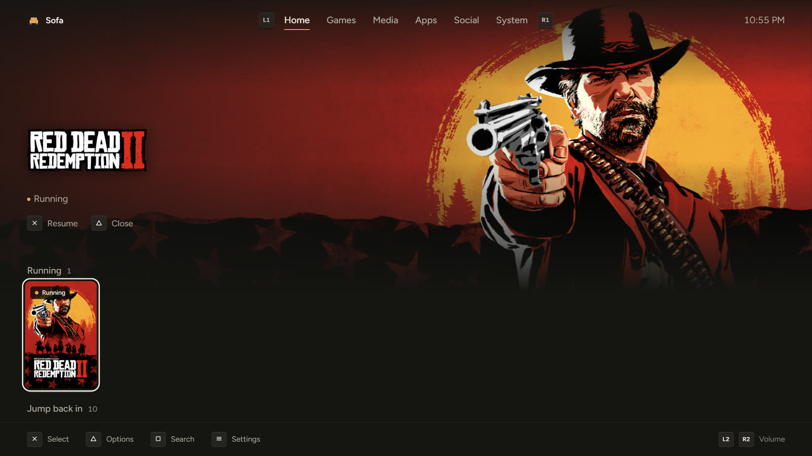
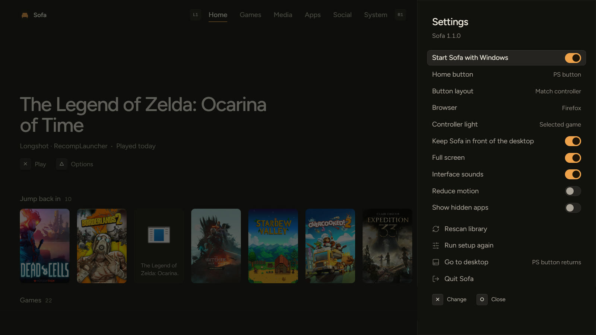
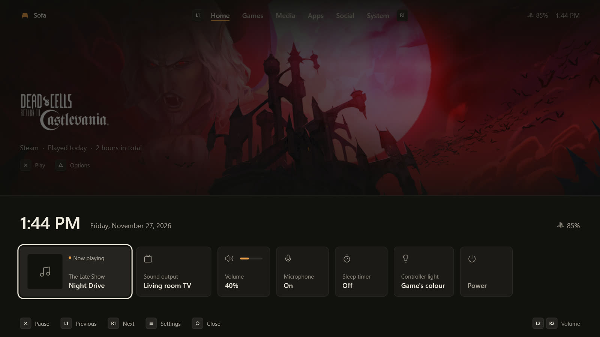
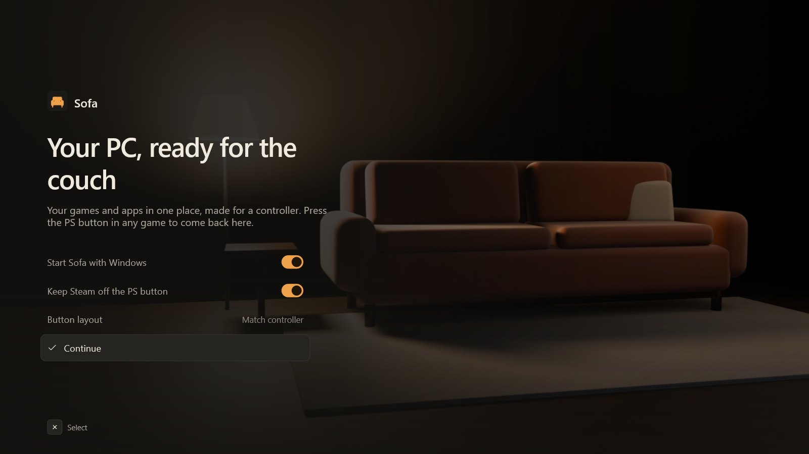

<div align="center">


# Sofa

**Your Windows gaming PC, as a console.**<br>
A controller-first home screen for the TV: every game, stream and app on one screen,<br>
the PS button always takes you home, and Windows stays out of sight until you leave.

[](https://github.com/AGregDev/sofa/releases/latest)
[](#install)
[](QA.md)
[](#small-and-fast)
[](LICENSE)

[**Download for Windows**](https://github.com/AGregDev/sofa/releases/latest) · [Features](#features) · [Controls](#controls) · [Build from source](#build-from-source)

<br>


</div>

<br>

## Why Sofa

Big Picture is a store. Windows is a desktop. Neither feels like the box under the TV.
Sofa is the missing home screen: it starts with Windows, sits in front like a console
dashboard, and gathers **Steam**, **RecompLauncher** ports, **streaming services** and
your **Start menu apps** into one calm, fast interface you never need a mouse for.

Sofa 2 is a single native executable, written in Rust with Direct2D. No browser engine,
no helper processes: about **60 MB of memory** on Home, and almost nothing while you play.

<table>
  <tr>
    <td width="50%"><br><b>PS button, anywhere.</b> Sofa comes forward with the game you were playing first, ready to resume, close or force close.</td>
    <td width="50%"><br><b>Everything in its place.</b> Games, Media and Apps fill themselves from Steam, RecompLauncher and the Start menu.</td>
  </tr>
  <tr>
    <td><br><b>Search everything.</b> On-screen keyboard with Paste, results as you type, or just type on a keyboard.</td>
    <td><br><b>Settings from the pad.</b> Start with Windows, Home button, button layout, Steam, browser, sounds, motion.</td>
  </tr>
  <tr>
    <td><br><b>PS on Home: the quick menu.</b> What is playing (Spotify included), sound output, volume, microphone, sleep timer and power, all from the pad.</td>
    <td><br><b>Fall asleep on the sofa.</b> A sleep timer for the PC: a minute before, Sofa asks once, then the PC sleeps with your game or film waiting.</td>
  </tr>
  <tr>
    <td><br><b>Ready in one screen.</b> Start with Windows, keep Steam off the PS button, pick a button layout.</td>
    <td><br><b>Power and system.</b> Sleep, restart, go to the desktop and come back with PS, display and sound settings.</td>
  </tr>
</table>

## Features

**A console home**
- Starts with Windows and stays in front: the desktop, taskbar and Start menu never show unless you choose **Go to desktop**. The PS button brings Sofa back.
- **PS button from any game or app** opens Home with that app first: resume, close or force close. Starting a second game asks first.
- **Steam stays off the PS button:** Sofa switches off Steam's own PS-button setting for you, and pushes Steam back down if it still grabs the screen.
- Home rows: Running, Jump back in, Favorites, then Games, Media and Apps, each ending in an "All ..." tile. The hero tells you how long a game has been running and your total Steam play time.
- **The quick menu (PS on Home):** a bedside clock with what is playing (Spotify, a browser, any player: play, pause, skip), sound output (TV, headphones, the controller), volume, microphone mute, a **sleep timer** and power.
- Interface sounds, a short start-up, notices for controllers connecting and a low battery.

**Your whole library**
- Steam games with their own art and logos, RecompLauncher ports (Ocarina of Time, Majora's Mask and others), and every Start menu app with its icon.
- Sorted into Games, Media, Apps and System automatically. Move, rename, hide or favorite anything.
- Streaming: YouTube in its TV interface (the controller is its remote), Netflix, Disney+, Prime Video, Crunchyroll and Twitch, full screen in Edge, Chrome or Firefox with Sofa's own browser profile. Sofa's launch screen stays up until the service is ready.
- Discord voice: your channel with Mute, Deafen and Leave, recent channels on Home, and your servers' voice channels, after a one-time Connect (a Sofa 1.x sign-in carries over).
- **Spotify from the controller:** Liked Songs, your playlists and albums with their covers in a Music section and on Home; ✕ plays one in the Spotify app on this PC, Shuffle play from △. One-time Connect with a Spotify app you make (Spotify requires Premium for that).

**Made for the DualSense, works with any pad**
- No drivers: the DualSense is read directly, over USB or Bluetooth, with its battery and charging in the top bar. Xbox and other XInput pads work too, Guide button included.
- **Button layouts:** match the controller, PlayStation, Xbox (A B X Y) or Nintendo (confirm and back swapped).
- **Home button:** the PS button, or Create + Options if you would rather leave PS to Steam or the Game Bar.
- **Lights and the mute button:** the lightbar takes the colour of the game you rest on (or amber, or off), and the mute button mutes your microphone from inside any game, in Discord when you are in voice, with its LED lit, like a PS5.

### Small and fast

| | Sofa 1.3 (Electron) | Sofa 2.0 (native) |
| --- | --- | --- |
| Memory on Home | 564 MB, 6 processes | about 60 MB, 1 process |
| Memory while a game runs | same | about 17 MB (Sofa gives its art back) |
| Idle CPU | a helper polling every 30 ms | 0 % (it sleeps until something happens) |
| Download | 122 MB installer, 358 MB installed | 1.8 MB, one file |

Focus moves, scrolling and the hero art run at the display's refresh rate; art is decoded
off the main thread at the size it is drawn. Checked on every release by an automated
[QA run](QA.md).

## Install

1. Download **Sofa-Setup-2.2.1.exe** from the [latest release](https://github.com/AGregDev/sofa/releases/latest) and run it. It installs for your user only, with no admin prompt, and starts Sofa. It replaces Sofa 1.x and keeps your settings.
2. On the first screen, choose whether Sofa starts with Windows and keeps Steam off the PS button (with an Xbox controller: also Game Bar off the Xbox button), then **Continue**.
3. Steam also listens to the PS button. Sofa turns off Steam's **Guide button focuses Steam** for you: by itself when Steam is closed, or after asking when Steam is open (Steam restarts in the background). You can turn this off in Settings.

Windows SmartScreen may warn that the file is unsigned: choose **More info, Run anyway**.
To remove Sofa, use **Settings, Apps, Installed apps, Sofa, Uninstall**; your settings stay
in `%APPDATA%\sofa`.

## Controls

| Button | Action |
| --- | --- |
| D-pad, left stick | Move |
| ✕ | Open, play, select |
| ○ | Back (on Home: back to the first tile) |
| △ | Options: favorite, move, rename, hide; resume or close a running app |
| □ | Search |
| Options | Settings |
| L1, R1 | Previous, next section (in the quick menu: previous, next track) |
| L2, R2 | Volume (in the keyboard: Shift and Done) |
| PS | Home, from anywhere; on Home, the quick menu (or Create + Options, if you prefer) |
| Mute | Mutes the microphone, from any game |

Keyboard: arrows, Enter, Esc, Q and E for sections, M options, F search, O settings,
the minus and equals keys for volume, Home for the quick menu, type to search, Ctrl+V to
paste. **Ctrl+Alt+H** brings Sofa to the front from anywhere.

## Build from source

Needs Windows 10 or 11, Rust (stable, the `x86_64-pc-windows-gnu` toolchain) and MinGW-w64
binutils on `PATH` (for example [WinLibs](https://winlibs.com), in a folder without spaces).

```powershell
git clone https://github.com/AGregDev/sofa.git
cd sofa
$env:CARGO_TARGET_DIR = "$env:LOCALAPPDATA\sofa-build\target"   # keeps build paths short
cargo build --release
& "$env:CARGO_TARGET_DIR\release\sofa.exe" --windowed
```

| Command | What it does |
| --- | --- |
| `cargo build --release` | Builds `sofa.exe` (the app, its installer and uninstaller in one file) |
| `cargo test --workspace` | The VDF parser's 172 recorded cases and the Steam settings editor's tests |
| `powershell -ExecutionPolicy Bypass -File qa\qa.ps1` | Automated QA: drives every screen, checks memory and CPU, writes `shots\qa.txt` |
| `sofa.exe --windowed` | Runs in a window instead of full screen (`--log` writes `%TEMP%\sofa-native.log`) |

Copy `sofa.exe` to a name containing "setup" (`Sofa-Setup-2.2.1.exe`) and it installs itself.

## How it works

```
sofa.exe ─ one window, one message loop: draws only while something moves
   ├─ gfx      Direct2D on a DXGI flip swap chain, DirectWrite (Figtree), WIC decoding thread
   ├─ input    XInput (Guide via XInputGetStateEx), the DualSense over raw HID on its own thread
   │           (buttons in, lightbar, player light and mute LED out, only when they change)
   ├─ audio    sound outputs, volume and the microphone (Windows' endpoint APIs)
   ├─ media    Now playing from Windows' media sessions, on its own thread
   ├─ spotify  your Spotify library and playback (Web API, PKCE sign-in), on its own thread
   ├─ shell    foreground events: stays in front, guards the desktop, pushes Steam back
   ├─ library  Steam manifests and art (crates/vdf), RecompLauncher, the Start menu
   └─ steam    turns off Steam's PS-button setting in localconfig.vdf, safely (crates/steam)
```

- The DualSense thread keeps reading while a game has focus, so the PS button reaches Sofa from inside any game. Windows tells Sofa when another window comes to the front; there is no polling helper.
- The Start menu listing and program icons come from a short-lived `sofa.exe --scan` at low priority, so Windows' icon code never stays in Sofa's memory.
- Settings, overrides and play history live in `%APPDATA%\sofa\sofa.json`, the same file Sofa 1.x used.
- Sofa 2 was ported from the Electron app with [rust-anything](https://github.com/erkamyaman/rust-anything): the VDF parser is checked against 172 cases recorded from the original. The port's decisions are in [docs/port](docs/port/DECISIONS.md).

More in [PRODUCT.md](PRODUCT.md) (what Sofa promises and why), [CLAUDE.md](CLAUDE.md) (architecture and rules for contributors and coding agents) and [QA.md](QA.md).

## Credits

- Icons follow [Lucide](https://lucide.dev) (ISC). Brand marks from [Simple Icons](https://simpleicons.org) (CC0).
- [Figtree](https://github.com/erikdkennedy/figtree) by Erik Kennedy (SIL Open Font License).
- Interface direction follows the unslop skill by Damir Sokolovsky ([@heydamir](https://x.com/heydamir)), CC BY 4.0.
- The welcome scene is rendered in Blender from `assets/blender/make_assets.py`.

PlayStation, DualSense and the PlayStation logo are trademarks of Sony Interactive
Entertainment. Steam is a trademark of Valve. Xbox is a trademark of Microsoft.
Sofa is a free, unofficial project and is not affiliated with or endorsed by any of them.

## License

[MIT](LICENSE)
