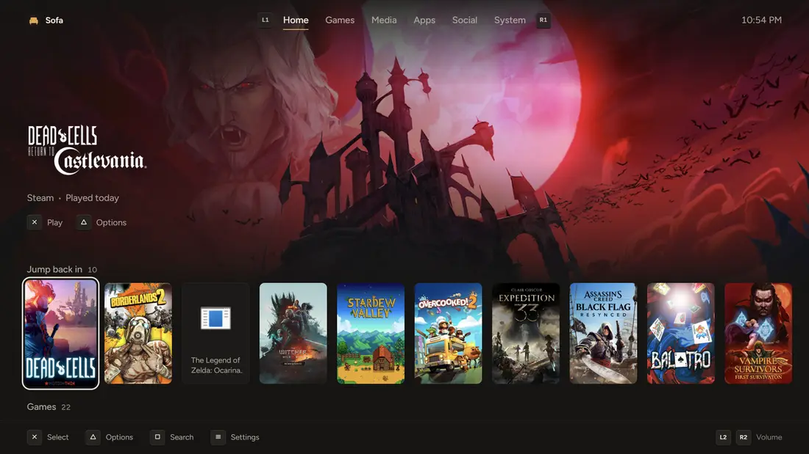
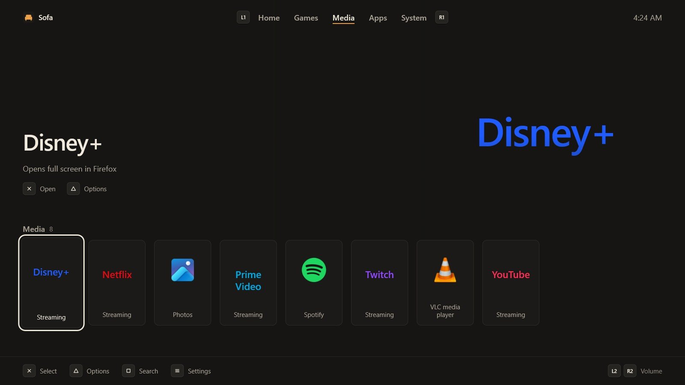
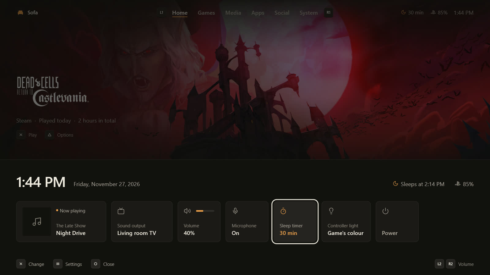
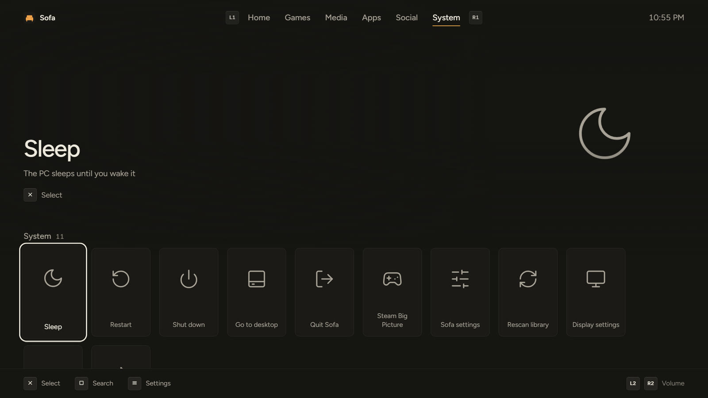

<div align="center">


# Sofa

**Your gaming PC, as a console. On Windows and Linux.**<br>
A controller-first home screen for the TV: every game, stream and app on one screen,<br>
the PS button always takes you home, and the desktop stays out of sight until you leave.

[](https://github.com/AGregDev/sofa/releases/latest)
[](#windows)
[](#linux)
[](QA.md)
[](#small-and-fast)
[](LICENSE)

[**Download**](https://github.com/AGregDev/sofa/releases/latest) · [Install](#install) · [Connect Discord and Spotify](#connect-discord-and-spotify) · [Controls](#controls) · [Build from source](#build-from-source)

<br>



</div>

<br>

## Why Sofa

Big Picture is a store. A desktop is a desktop. Neither feels like the box under the TV.
Sofa is the missing home screen: it starts with your PC, sits in front like a console
dashboard, and gathers **Steam**, **streaming services** and **your apps** into one calm,
fast interface you never need a mouse for.

Sofa is one native program written in Rust, with no browser engine and no helper processes:
**under 80 MB of memory** on Home, and a fraction of that while you play. It draws with Direct2D on
Windows, and on Linux it is an X11 program drawn on the CPU, with the same look.

<table>
  <tr>
    <td width="50%"><br><b>PS button, anywhere.</b> Sofa comes forward with the game you were playing first, ready to resume, close or force close.</td>
    <td width="50%"><br><b>Everything in its place.</b> Games, Media and Apps fill themselves from Steam, RecompLauncher, the Start menu or your desktop's apps.</td>
  </tr>
  <tr>
    <td><br><b>Search everything.</b> On-screen keyboard with Paste, results as you type, or just type on a keyboard.</td>
    <td><br><b>Settings from the pad.</b> Start with your PC, Home button, button layout, Steam, browser, sounds, motion.</td>
  </tr>
  <tr>
    <td><br><b>PS on Home: the quick menu.</b> What is playing (Spotify included), sound output, volume, microphone, sleep timer, performance and power, all from the pad.</td>
    <td><br><b>Fall asleep on the sofa.</b> A sleep timer for the PC: a minute before, Sofa asks once, then the PC sleeps with your game or film waiting.</td>
  </tr>
  <tr>
    <td><br><b>Ready in one screen.</b> Start with your PC, keep Steam off the PS button, pick a button layout.</td>
    <td><br><b>Power and system.</b> Sleep, restart, go to the desktop and come back with PS, display and sound settings.</td>
  </tr>
</table>

## Features

**A console home**
- Starts with your PC and stays in front: the desktop, taskbar and Start menu never show unless you choose **Go to desktop**. The PS button brings Sofa back.
- **PS button from any game or app** opens Home with that app first: resume, close or force close. Starting a second game asks first, and a game comes forward only once you let go of ✕, so it never reads the press.
- **Steam stays off the PS button:** Sofa switches off Steam's own PS-button setting for you, and pushes Steam back down if it still grabs the screen.
- Home rows: Running, Discord voice, Jump back in, Favorites, Games, Media, Music and Apps, each long row ending in an "All ..." tile. The hero tells you how long a game has been running and your total Steam play time.
- **The quick menu (PS on Home):** a bedside clock with what is playing (Spotify, a browser, any player: play, pause, skip), sound output (TV, headphones, the controller), volume, microphone mute, a **sleep timer**, **performance** and power.
- **Performance:** CPU and GPU use, memory and video memory, and **Show on screen**: a compact overlay with the same numbers and the frame rate of the game in front, which stays over every game and app. ([About the frame rate](#the-performance-overlay))
- Interface sounds, a short start-up, notices for controllers connecting and a low battery.

**Your whole library**
- Steam games with their own art and logos (on Linux from the native, Flatpak or Snap Steam), RecompLauncher ports on Windows, and every app with its icon: the Start menu on Windows, your desktop's apps on Linux (Flatpak and Snap ones included).
- Sorted into Games, Media, Apps and System automatically. Move, rename, hide or favorite anything.
- Streaming: YouTube in its TV interface (the controller is its remote), Netflix, Disney+, Prime Video, Crunchyroll and Twitch, full screen in Edge, Chrome, Chromium or Firefox with Sofa's own browser profile. Sofa's launch screen stays up until the service is ready.
- **Discord voice:** your channel with Mute, Deafen and Leave, recent channels on Home, and your servers' voice channels. [Connect it once](#connect-discord).
- **Spotify from the controller:** Liked Songs, your playlists and albums with their covers in a Music section and on Home; ✕ plays one in the Spotify app on this PC, Shuffle play from △. [Connect it once](#connect-spotify).

**Made for the DualSense, works with any pad**
- No extra drivers: the DualSense is read directly, over USB or Bluetooth, with its battery and charging in the top bar. Xbox and other pads work too, Guide button included.
- **Button layouts:** match the controller, PlayStation, Xbox (A B X Y) or Nintendo (confirm and back swapped).
- **Home button:** the PS button, or Create + Options if you would rather leave PS to Steam or the Game Bar.
- **Lights and the mute button:** the lightbar takes the colour of the game you rest on (or amber, or off), and the mute button mutes your microphone from inside any game, in Discord when you are in voice, with its LED lit, like a PS5.

### Small and fast

| | Sofa 1.3 (Electron) | Sofa 2.3 on Windows | Sofa 2.3 on Linux |
| --- | --- | --- | --- |
| Memory on Home | 564 MB, 6 processes | 55 to 70 MB, 1 process | about 40 MB, 1 process |
| Memory while a game runs | same | about 18 MB (Sofa gives its art back) | about 33 MB |
| Idle CPU | a helper polling every 30 ms | 0 % (it sleeps until something happens) | 0 % |
| Download | 122 MB installer, 358 MB installed | 2.1 MB, one file | 4.6 MB, one AppImage |

Focus moves, scrolling and the hero art run at the display's refresh rate; art is decoded
off the main thread at the size it is drawn. Every release is optimized (link-time
optimization, one code unit, symbols stripped) and checked by the automated [QA run](QA.md)
on both systems.

## Install

### Windows

1. Download **`Sofa-Setup-<version>.exe`** from the [latest release](https://github.com/AGregDev/sofa/releases/latest) and run it. It installs for your user only, with no admin prompt, and starts Sofa. It replaces any older Sofa and keeps your settings.
2. On the first screen, choose whether Sofa starts with Windows and keeps Steam off the PS button (with an Xbox controller: also Game Bar off the Xbox button), then **Continue**.
3. Steam also listens to the PS button. Sofa turns off Steam's **Guide button focuses Steam** for you: by itself when Steam is closed, or after asking when Steam is open (Steam restarts in the background). You can turn this off in Settings.

Windows SmartScreen may warn that the file is unsigned: choose **More info, Run anyway**.
To remove Sofa, use **Settings, Apps, Installed apps, Sofa, Uninstall**; your settings stay
in `%APPDATA%\sofa`.

### Linux

For Ubuntu, Debian, Fedora, Arch and the rest (glibc 2.31 or later), on GNOME, KDE or any X11
desktop. Wayland sessions run Sofa through XWayland, which GNOME and KDE always have.

1. Download **`Sofa-Setup-<version>-x86_64.AppImage`** from the [latest release](https://github.com/AGregDev/sofa/releases/latest).
2. Make it executable and run it once:

   ```bash
   chmod +x Sofa-Setup-*-x86_64.AppImage
   ./Sofa-Setup-*-x86_64.AppImage
   ```

   It installs for your user only, with no password: the program goes to `~/.local/bin/sofa`,
   Sofa appears in your apps, and it starts. Running a newer setup AppImage updates it.
3. On the first screen, choose whether Sofa starts when you sign in and keeps Steam off the
   PS button, then **Continue**.

For the DualSense's lightbar and mute button, Sofa needs the access Steam's udev rules give
(there already when Steam came from your distribution; otherwise
`sudo apt install steam-devices` on Ubuntu and Debian, or your distribution's `steam-devices`
package). Without it every button still works.

If the AppImage does not start, your system lacks FUSE: install `fuse3` (or `libfuse2`), or
run it with `--appimage-extract-and-run`. To remove Sofa, right-click Sofa in your apps and
choose **Uninstall Sofa**, or run `~/.local/bin/sofa --uninstall`; your settings stay in
`~/.config/sofa`.

What Linux does not do yet, and why, is in [PRODUCT.md](PRODUCT.md#linux-23): apps that draw
through Wayland themselves get no Running card, the guard sees less of the desktop, there is no
Ctrl+Alt+H, and the performance overlay has no frame rate.

### The performance overlay

PS on Home, **Performance**, **Show on screen**: one line in the top left corner with CPU use,
GPU use, memory, video memory and the frame rate of the game in front, over every game and app
until you turn it off. Games in exclusive full screen hide it; their borderless or windowed
mode shows it.

On Windows the frame rate comes from the frames Windows sees a game present, as Game Bar's
does, so it needs the same permission: membership of **Performance Log Users**. Without it,
Performance offers **Frame rate in games: Allow**; Windows asks once for an administrator, and
the frame rate shows after you sign out and back in. It counts games made with DirectX 9 to 12;
Vulkan and OpenGL games show none yet. On Linux the overlay shows the other numbers (GPU use and
video memory for NVIDIA's driver and AMD cards).

## Connect Discord and Spotify

Both services only let an app control your account when you made that app yourself, so each
needs a one-time setup of about two minutes. Sofa walks you through the same steps on screen
and never sees your password. Do the steps on this PC: Sofa reads the IDs from the clipboard,
so a keyboard and mouse help for this once.

### Connect Discord

1. Have Discord open on this PC and signed in.
2. In Sofa, open **Social** and choose **Connect Discord**.
3. **Make a Discord application:** on [discord.com/developers/applications](https://discord.com/developers/applications) choose **New Application** and name it Sofa.
4. **Add the redirect:** under **OAuth2**, add the redirect `http://127.0.0.1` and save.
5. **Paste the Client ID:** copy the **Client ID** from OAuth2, then select this step in Sofa.
6. **Paste the Client Secret:** choose **Reset Secret**, copy the secret, then select this step in Sofa.
7. **Connect:** Discord asks you once to **Authorize** Sofa. Sofa comes back with "Discord connected".

Home then shows your voice channel with Mute, Deafen and Leave, and **Social** lists your
servers' voice channels. A sign-in made in Sofa 1.x carries over without these steps.

### Connect Spotify

Spotify allows apps in development only for accounts with **Spotify Premium**.

1. In Sofa, open **Music** (it shows when Spotify is installed) and choose **Connect Spotify**.
2. **Make a Spotify app:** on [developer.spotify.com/dashboard](https://developer.spotify.com/dashboard) choose **Create app**, name it Sofa and tick **Web API**.
3. **Add the redirect:** in the app's settings, add the redirect URI `http://127.0.0.1:7632/callback` and save. (The dashboard refuses the address without its port.)
4. **Paste the Client ID:** copy the **Client ID** from the app's settings, then select this step in Sofa.
5. **Sign in:** your browser opens once. Approve Sofa there and come back: Sofa says "Spotify connected".

**Music** and Home's Music row then list Liked Songs, your playlists and saved albums with
their covers. ✕ plays one in the Spotify app on this PC (Sofa starts it when it is closed),
and △ offers Shuffle play and Open in Spotify. The sign-in is kept encrypted for your account:
with DPAPI on Windows, with a key only your account can read on Linux.

## Controls

| Button | Action |
| --- | --- |
| D-pad, left stick | Move |
| ✕ | Open, play, select |
| ○ | Back (on Home: back to the first tile) |
| △ | Options: favorite, move, rename, hide; resume or close a running app |
| □ | Search |
| Options | Settings |
| L1, R1 | Previous, next section (in the quick menu: previous, next track) |
| L2, R2 | Volume (in the keyboard: Shift and Done) |
| PS | Home, from anywhere; on Home, the quick menu (or Create + Options, if you prefer) |
| Mute | Mutes the microphone, from any game |

Keyboard: arrows, Enter, Esc, Q and E for sections, M options, F search, O settings,
the minus and equals keys for volume, Home for the quick menu, type to search, Ctrl+V to
paste. On Windows **Ctrl+Alt+H** brings Sofa to the front from anywhere.

## Versions

Only the [latest release](https://github.com/AGregDev/sofa/releases/latest) is supported.
Sofa 2.3 is the first for Linux; everything before it is deprecated:

| Version | Status |
| --- | --- |
| 2.3 | Supported: Windows and Linux |
| 2.0 to 2.2.2 | Deprecated. Run the newest setup file: it replaces them and keeps your settings |
| 1.x (Electron) | Deprecated. The native Sofa replaced it in 2.0; its setup removes 1.x and keeps the settings and the Discord sign-in |

## Build from source

### Windows

Needs Windows 10 or 11, Rust (stable, the `x86_64-pc-windows-gnu` toolchain) and MinGW-w64
binutils on `PATH` (for example [WinLibs](https://winlibs.com), in a folder without spaces).

```powershell
git clone https://github.com/AGregDev/sofa.git
cd sofa
$env:CARGO_TARGET_DIR = "$env:LOCALAPPDATA\sofa-build\target"   # keeps build paths short
cargo build --release
& "$env:CARGO_TARGET_DIR\release\sofa.exe" --windowed
```

| Command | What it does |
| --- | --- |
| `cargo build --release` | Builds `sofa.exe` (the app, its installer and uninstaller in one file) |
| `cargo test --workspace` | The VDF parser's 172 recorded cases, the Steam settings editor's tests and the app's |
| `powershell -ExecutionPolicy Bypass -File qa\qa.ps1` | Automated QA: drives every screen, checks memory and CPU, writes `shots\qa.txt` |
| `sofa.exe --windowed` | Runs in a window instead of full screen (`--log` writes `%TEMP%\sofa-native.log`) |

Copy `sofa.exe` to a name containing "setup" (`Sofa-Setup-2.3.0.exe`) and it installs itself.

### Linux

Needs Rust (stable, 1.97 or later, from [rustup](https://rustup.rs)) and a C compiler (for
rustls' cryptography: `build-essential` on Ubuntu and Debian, `base-devel` on Arch). No
development packages: Sofa loads the desktop's own X11, xkbcommon and PulseAudio libraries
when it runs.

```bash
git clone https://github.com/AGregDev/sofa.git
cd sofa
cargo build --release
target/release/sofa --windowed     # try it in a window
target/release/sofa --install      # install it as the AppImage does
```

| Command | What it does |
| --- | --- |
| `cargo build --release` | Builds `target/release/sofa`, optimized for x86-64-v2 (every x86-64 CPU since 2009) |
| `cargo test --workspace` | The same unit tests, plus the Linux renderer's, desktop entries' and sound's |
| `xvfb-run -a bash qa/qa.sh` | The automated QA run (76 checks, as on Windows), screenshots in `shots/linux/` |
| `bash packaging/linux/build-appimage.sh` | Packs `dist/Sofa-Setup-<version>-x86_64.AppImage` |

The [Linux workflow](.github/workflows/linux.yml) does all four on every push, on Ubuntu
20.04 so the AppImage runs on any distribution with glibc 2.31 or later, and attaches the
AppImage to each release.

## How it works

On Windows:

```
sofa.exe ─ one window, one message loop: draws only while something moves
   ├─ gfx      Direct2D on a DXGI flip swap chain, DirectWrite (Figtree), WIC decoding thread
   ├─ input    XInput (Guide via XInputGetStateEx), the DualSense over raw HID on its own thread
   │           (buttons in, lightbar, player light and mute LED out, only when they change)
   ├─ audio    sound outputs, volume and the microphone (Windows' endpoint APIs)
   ├─ media    Now playing from Windows' media sessions, on its own thread
   ├─ spotify  your Spotify library and playback (Web API, PKCE sign-in), on its own thread
   ├─ perf     CPU and GPU use, memory, video memory (DXGI, GPU performance counters) and
   │           games' frame rate (an ETW session, only while the overlay is up)
   ├─ shell    foreground events: stays in front, guards the desktop, pushes Steam back
   ├─ library  Steam manifests and art (crates/vdf), RecompLauncher, the Start menu
   └─ steam    turns off Steam's PS-button setting in localconfig.vdf, safely (crates/steam)
```

On Linux the same modules sit on Linux's own pieces: a winit X11 window drawn with tiny-skia
and swash (Figtree, laid out as DirectWrite lays it out), evdev for every pad and hidraw for
the DualSense's lights, EWMH for the window manager, desktop entries and icon themes for the
apps (listed by the `--scan` child), MPRIS for Now playing, `pactl` for sound, NVML and amdgpu
for video memory, Discord's Unix socket, and rustls for HTTPS. Settings live in
`~/.config/sofa/sofa.json`, with the same keys as on Windows.

- The controller is read whichever window has the focus, so the PS button reaches Sofa from inside any game. The system tells Sofa when another window comes to the front; there is no polling helper.
- App lists and icons come from a short-lived `sofa --scan` at low priority, so the system's icon code never stays in Sofa's memory.
- Settings, overrides and play history live in `%APPDATA%\sofa\sofa.json` on Windows, the same file Sofa 1.x used.
- Sofa 2 was ported from the Electron app with [rust-anything](https://github.com/erkamyaman/rust-anything): the VDF parser is checked against 172 cases recorded from the original. The port's decisions are in [docs/port](docs/port/DECISIONS.md).

More in [PRODUCT.md](PRODUCT.md) (what Sofa promises and why), [CLAUDE.md](CLAUDE.md) (architecture and rules for contributors and coding agents) and [QA.md](QA.md).

## Credits

- Icons follow [Lucide](https://lucide.dev) (ISC). Brand marks from [Simple Icons](https://simpleicons.org) (CC0).
- [Figtree](https://github.com/erikdkennedy/figtree) by Erik Kennedy (SIL Open Font License).
- Interface direction follows the unslop skill by Damir Sokolovsky ([@heydamir](https://x.com/heydamir)), CC BY 4.0.
- The welcome scene is rendered in Blender from `assets/blender/make_assets.py`.

PlayStation, DualSense and the PlayStation logo are trademarks of Sony Interactive
Entertainment. Steam is a trademark of Valve. Xbox is a trademark of Microsoft. Linux is a
trademark of Linus Torvalds. Sofa is a free, unofficial project and is not affiliated with or
endorsed by any of them.

## License

[MIT](LICENSE)
